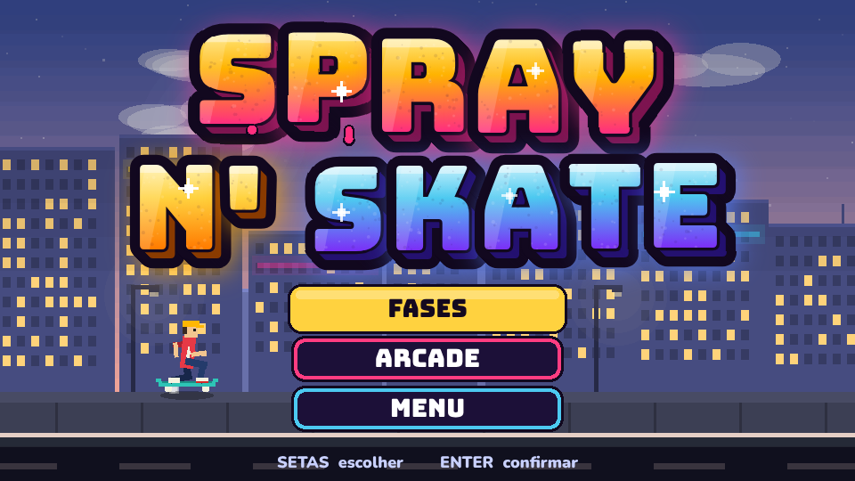
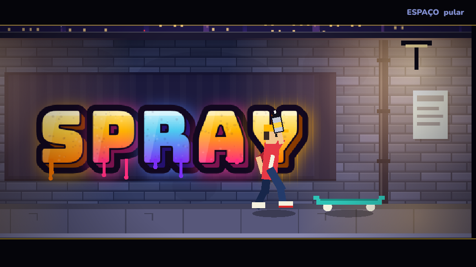
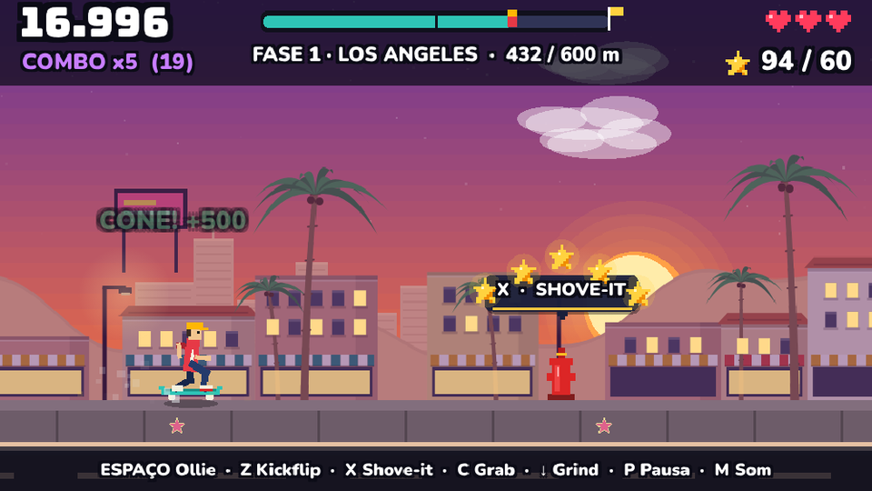
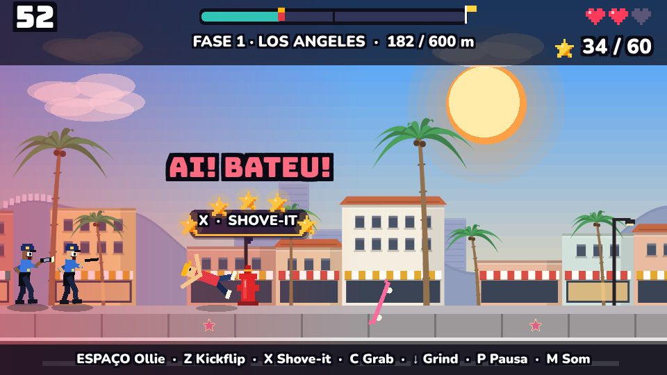
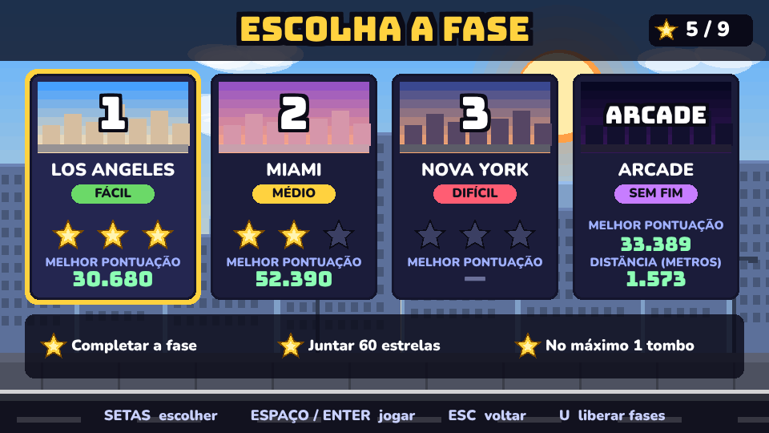
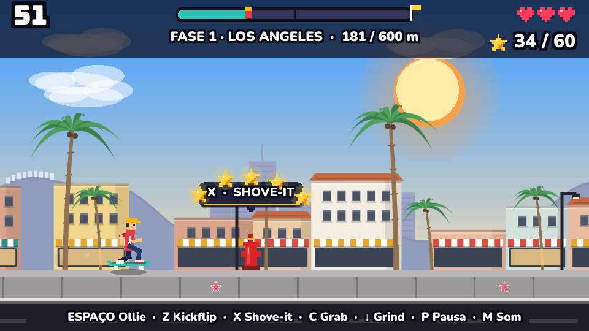
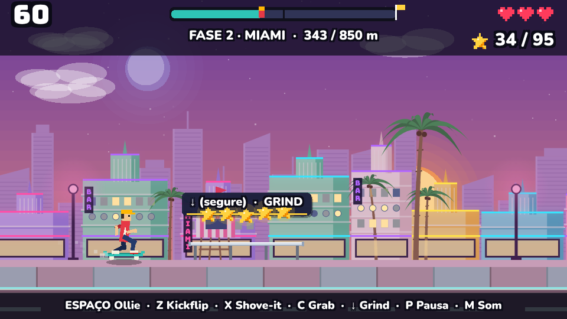
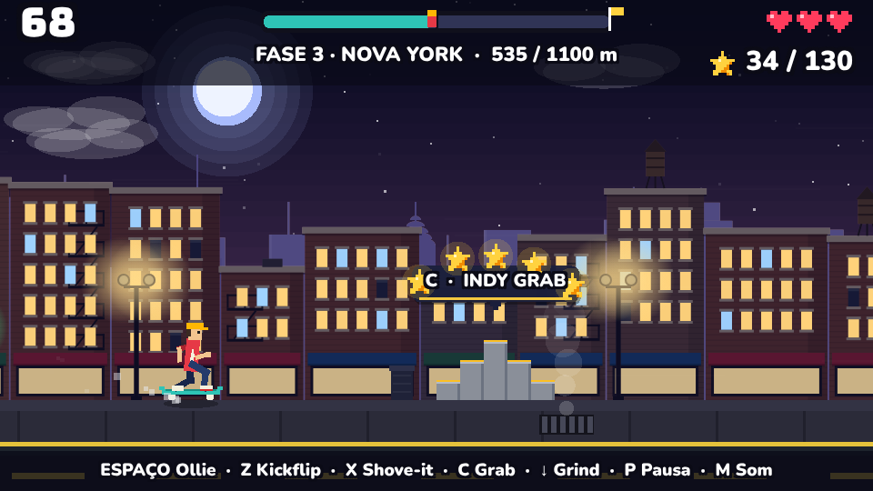
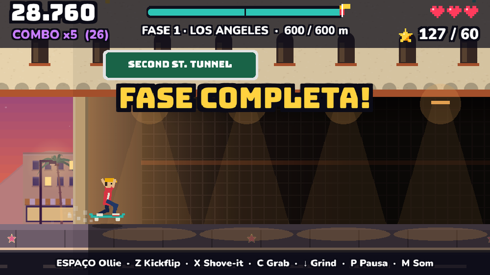
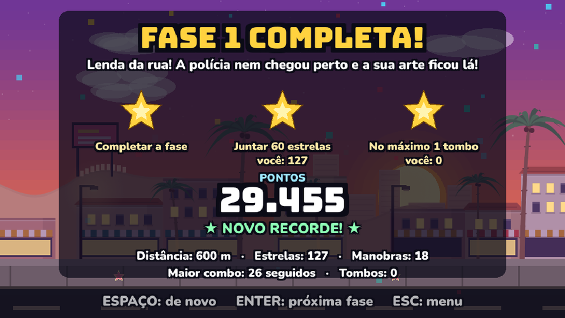

# 🛹 SPRAY N' SKATE

> Jogo 2D de skate em que **cada obstáculo exige uma manobra específica** e a polícia está sempre na sua cola. Feito com **[melonJS](https://melonjs.org) 18** para o trabalho final de Desenvolvimento de Games.



**▶ Jogar online:** `https://SEU-USUARIO.github.io/NOME-DO-REPOSITORIO/` *(veja [Publicação](#-publicação-no-github-pages))*

---

## 📖 História

Depois de uma noite de spray na mão, o nosso pichador termina a sua obra-prima no muro: **SPRAY**. Só que as sirenes já estão chegando — viatura, policiais e até um helicóptero com holofote. Ele larga a lata, pula no skate e foge.

A fuga atravessa **três cidades**, cada uma mais difícil que a anterior, e termina sempre da mesma forma: entrando num **túnel** onde a polícia não alcança.

| Fase | Cidade | Final da fase |
|---|---|---|
| 1 · fácil | **Los Angeles** — de Venice Beach ao pôr do sol na Sunset Blvd | Second St. Tunnel |
| 2 · médio | **Miami** — de South Beach à noite de neon em Ocean Drive | Port of Miami Tunnel |
| 3 · difícil | **Nova York** — do entardecer no Brooklyn à noite em Manhattan | Holland Tunnel |

Uma única **cutscene sem legendas** (a ação conta a história) abre todas as fases e o modo Arcade. Dá para pular com `ESPAÇO`, `ENTER`, `ESC` ou clicando.



## 🎮 Como jogar

O skatista anda sozinho; você decide **quando pular e qual manobra fazer**. Cada obstáculo tem uma **placa** mostrando a tecla da manobra que ele exige.

| Tecla | Manobra |
|---|---|
| `ESPAÇO` / `↑` / `W` | **Ollie** (pulo) |
| `Z` (ou `J`) | **Kickflip** — a tábua gira no próprio eixo |
| `X` (ou `K`) | **Shove-it** — a tábua gira de lado |
| `C` (ou `L`) | **Indy Grab** — pega a tábua no ar |
| `↓` / `S` (**segurar**) | **Grind** — segure ao cair sobre o corrimão |
| `P` / `ESC` | Pausa |
| `M` | Liga/desliga o som |

Nos menus: `←` `→` escolhem, `ESPAÇO`/`ENTER` confirmam, `ESC` volta (ou use o mouse/toque). Em celulares e tablets aparecem botões de toque na parte de baixo da tela.



### Obstáculos × manobras

| Obstáculo | Manobra exigida | Pontos base |
|---|---|---|
| 🔶 Cone | Ollie | 100 |
| 🪑 Banco da praça | Kickflip | 250 |
| 🧯 Hidrante | Shove-it | 250 |
| 🪜 Escadaria | Indy Grab | 350 |
| 🛤️ Corrimão | Grind (cair sobre ele segurando `↓`) | 400 |

> **Regra:** bater no obstáculo **ou** passar sem a manobra certa = **tombo** (perde 1 vida ❤️). O jogo começa com 3 vidas.
> Dá para encadear **2 manobras no mesmo pulo**; o jogo guarda o toque se você apertar a segunda um pouco antes da primeira terminar.

### 🚓 A polícia

A cada **tombo**, dois policiais entram correndo pela esquerda da tela, com sirene e apito, e se aproximam do skatista. Se ele se levanta, eles desistem e vão embora cansados. No **último tombo** (sem vidas) eles alcançam o skatista: **"PEGARAM VOCÊ!"**.



### Pontuação, combo e itens

- **Combo:** cada obstáculo vencido em sequência aumenta o combo; a cada 4 seguidos o **multiplicador** sobe (até **x5**). Um tombo zera o combo.
- ⭐ **Estrelas:** arcos de estrelas aparecem sobre os obstáculos — +25 pontos cada. Elas contam para o objetivo da fase.
- ❤️ **Coração:** +1 vida (ou +500 pontos se você já estiver com 3).
- 🥤 **Energético:** **câmera lenta** por 5 segundos.
- 🏁 **Chegada:** o skatista entra no túnel, a tela escurece (fecha em íris) e aparece o relatório, com bônus de 1000 pontos por vida restante.

### Modos e estrelas de avaliação

- **Fases (1 a 3):** cada fase tem **3 objetivos**, que valem 3 estrelas de avaliação — *completar a fase*, *juntar N estrelas* (60 / 95 / 130) e *no máximo 1 tombo*. A fase seguinte só abre ao completar a anterior (na tela de seleção, `U` libera todas).
- **Arcade:** sem linha de chegada; a velocidade e a dificuldade só aumentam (escadarias a partir de 120 m e corrimões a partir de 280 m). Vale a maior pontuação.
- A **melhor pontuação**, as estrelas de cada fase, o recorde do Arcade e os ajustes de som ficam salvos no navegador.



| Fase | Extensão | Velocidade | Obstáculos | Detalhe |
|---|---|---|---|---|
| 1 · Los Angeles | 600 m | 310 → 430 px/s | cone, banco, hidrante, escadaria | começa com tutorial na ordem dos obstáculos |
| 2 · Miami | 850 m | 360 → 500 px/s | + **corrimão** (grind) | noite de neon |
| 3 · Nova York | 1100 m | 410 → 580 px/s | todos, mais frequentes | até o helicóptero entra na perseguição |
| Arcade | infinito | 330 → 760 px/s | liberados aos poucos | 4 cenários originais em loop |

| Los Angeles | Miami | Nova York |
|---|---|---|
|  |  |  |

| Túnel de chegada | Relatório da fase |
|---|---|
|  |  |

### Menu

No título há três botões: **FASES**, **ARCADE** e **MENU**. No MENU ficam as abas **COMANDOS** (teclas), **SOM** (volume da música e dos efeitos, mudo) e **PARTICIPANTES** (a equipe).

## 🧰 Tecnologias

- **[melonJS 18](https://github.com/melonjs/melonJS)** — engine 2D (renderer WebGL com fallback para Canvas)
- **[Vite](https://vitejs.dev)** — servidor de desenvolvimento e *build*
- JavaScript (ES Modules), **sem imagens externas**: todos os gráficos são desenhados por código (formas, *pixel art* e canvases pré-renderizados) e **todo o áudio é sintetizado** por um script Python (`tools/make_audio.py`).
- Fontes embutidas via [`@fontsource`](https://fontsource.org) (Bungee e Nunito), sem depender de internet.

### Recursos da melonJS utilizados

| Recurso | Onde |
|---|---|
| `me.video.init`, escala automática (`scale: "auto"`, `fit`) | `src/main.js` |
| `me.state` + `me.Stage` (6 telas: título, cutscene, fases, menu, jogo, resultado) e `me.state.transition` | `src/main.js`, `src/states.js`, `src/scenes/*` |
| `me.Renderable` (entidades próprias com `update()`/`draw()`) | `src/entities/*`, `src/game/director.js` |
| `me.game.world` (contêiner, ordem de desenho por `z`) | `src/scenes/play.js` |
| Renderer (`fillRect`, `fillArc`, `fillEllipse`, `drawImage`, `save/translate/rotate`…) | `src/entities/*`, `src/scenes/cutscene.js` |
| `me.Text` (HUD, menus e textos) | `src/game/label.js` |
| `me.input` (`bindKey`, `isKeyPressed`, `triggerKeyEvent` p/ botões de toque) | `src/main.js`, `src/game/director.js`, `src/game/menuinput.js` |
| `me.audio` + `me.loader.preload` (música em loop + 23 efeitos) | `src/game/audio.js`, `src/main.js` |
| `me.game.viewport` (`shake`, `fadeOut`) | `src/game/director.js`, `src/scenes/*` |
| `me.save` (progresso, estrelas, recordes e ajustes em `localStorage`) | `src/game/progress.js`, `src/game/settings.js` |
| `me.Polygon` / `me.Vector2d` (formas preenchidas), `me.device.onReady` | `src/game/shapes.js`, `src/game/actors.js`, `src/entities/gate.js`, `src/main.js` |

## ⚡ Desempenho

- Os cenários das cidades, os túneis e a cutscene são **desenhados uma única vez em canvases pré-renderizados** (em cache) e só rolam na tela com `drawImage`; a troca dia → noite é um *crossfade* entre duas versões do mesmo cenário.
- Poucas texturas diferentes por quadro (muitas texturas pequenas forçam trocas de lote no WebGL), então o jogo mantém a velocidade estável.
- O passo de tempo é limitado a 50 ms por quadro: uma queda de FPS não faz o skatista "atravessar" um obstáculo.

## 🚀 Instalação e execução

Pré-requisito: **[Node.js](https://nodejs.org) 18 ou superior**.

```bash
git clone https://github.com/SEU-USUARIO/NOME-DO-REPOSITORIO.git
cd NOME-DO-REPOSITORIO
npm install
npm run dev        # abre em http://localhost:5173
```

Outros comandos:

```bash
npm run build      # gera a versão final em dist/
npm run preview    # serve o dist/ para testar (http://localhost:4173)
npm run audio      # (opcional) regenera os .wav — requer Python 3 + numpy
```

> ⚠️ O jogo precisa ser servido por HTTP (`npm run dev`, `npm run preview` ou GitHub Pages). Abrir o `index.html` direto do disco (`file://`) é bloqueado pelos navegadores por causa dos módulos ES e do carregamento de áudio.

### 🌐 Publicação no GitHub Pages

O repositório já inclui o workflow `.github/workflows/pages.yml`:

1. Envie o código para a branch `main`.
2. No GitHub: **Settings → Pages → Build and deployment → Source: GitHub Actions**.
3. Aguarde o workflow terminar (aba **Actions**). O link aparece no próprio workflow e em *Settings → Pages*.
4. Cole o link no topo deste README.

### 🔧 Atalhos para testes e apresentação

| Endereço | O que faz |
|---|---|
| `/?play=1` · `?play=2` · `?play=3` · `?play=arcade` | abre direto a fase (ou o Arcade), com a cutscene |
| `/?cutscene=1` | abre só a cutscene |
| `&debug` (junto de qualquer um) | expõe `window.__radroll` no console (`director`, `session`, `skater`) |

Exemplo para ver o final de uma fase sem jogar tudo: abra `/?play=1&debug` e rode no console `__radroll.session.dist = __radroll.director.goalPx - 600`.

## 🗂️ Estrutura do projeto

```
spray-n-skate/
├── index.html                 # página (contêiner do canvas + botões de toque)
├── vite.config.js
├── package.json
├── public/
│   ├── audio/                 # música e efeitos (.wav gerados por tools/make_audio.py)
│   └── favicon.svg
├── tools/make_audio.py        # sintetizador da trilha sonora e dos efeitos
├── docs/                      # capturas de tela e roteiro de apresentação
├── .github/workflows/pages.yml
└── src/
    ├── main.js                # boot: vídeo, áudio, teclas, loader, telas
    ├── config.js              # constantes: física, obstáculos, zonas, fases, Arcade
    ├── states.js              # estados extras e "o que vai ser jogado"
    ├── scenes/
    │   ├── title.js           # título + botões FASES / ARCADE / MENU
    │   ├── levels.js          # seleção de fases (pontuação e estrelas)
    │   ├── options.js         # menu: COMANDOS / SOM / PARTICIPANTES
    │   ├── cutscene.js        # cutscene de abertura (pichação, perseguição e fuga)
    │   ├── play.js            # monta o jogo (camadas e z-order)
    │   └── result.js          # relatório da fase
    ├── game/
    │   ├── director.js        # regras: manobras, colisão, combo, vidas, tombo, spawn, fases
    │   ├── actors.js          # pessoas, viatura, helicóptero e holofote (cinemática inversa)
    │   ├── audio.js           # atalhos de som/música
    │   ├── label.js           # texto com contorno (me.Text)
    │   ├── logo.js            # logo SPRAY N' SKATE e letras de spray
    │   ├── palette.js         # interpolação das cores dos cenários
    │   ├── pixels.js          # mini sprites em pixel art
    │   ├── shapes.js          # estrelas, cadeado e formas da interface
    │   ├── progress.js        # fases, estrelas e recordes salvos (me.save)
    │   ├── settings.js        # volume e mudo salvos
    │   └── menuinput.js       # teclado/mouse/toque dos menus
    └── entities/
        ├── skater.js          # skatista: física, manobras, poses
        ├── obstacles.js       # obstáculos, placas de manobra, spawn
        ├── background.js      # céu, sol/lua, camadas em parallax, chão
        ├── cities.js          # cenários de Los Angeles, Miami e Nova York
        ├── gate.js            # túneis de chegada
        ├── police.js          # policiais que se aproximam no tombo
        ├── pickups.js         # estrelas e power-ups
        ├── fx.js              # partículas, linhas de velocidade, textos flutuantes
        └── hud.js             # HUD e faixas de capítulo
```

## ⚙️ Como funciona (resumo técnico)

- **Director** (`src/game/director.js`) é um `Renderable` invisível cujo `update()` roda o jogo: fases `countdown → play → bail → finish`, geração de obstáculos com espaçamento proporcional à velocidade (sempre dá tempo de reagir), colisão por retângulos (AABB) e julgamento das manobras.
- **Julgamento:** quando a traseira do skatista passa pelo fim do obstáculo, o jogo confere se a manobra exigida foi executada naquele pulo (ou, no corrimão, se houve *grind*). Se não, o skatista cai, perde uma vida e a polícia aparece.
- **Skatista e personagens:** o corpo é desenhado com cinemática inversa de 2 ossos (pernas e braços), então cada pose (pulo, kickflip, shove-it, grab, grind, queda, perseguição) é definida só pelos pontos de apoio.
- **Cenários:** três cidades, cada uma com duas paletas (por exemplo, dia e pôr do sol em Los Angeles) que se misturam ao longo da fase; o Arcade usa quatro zonas originais (Vila Rad, Centro, Avenida Neon e Madrugada).
- **Final da fase:** o `Director` entra na fase `finish`: o skatista rola para dentro do túnel, uma íris preta fecha e só então o relatório sobe.
- **Cutscene:** linha do tempo própria, com câmera de cinema (travelling, zoom e tremida), tudo desenhado por código.

## 👥 Equipe

| Nome | Áreas do projeto |
|---|---|
| Pedro Henrique Rocha Lima | coordenação, arquitetura (`Director`, `config`, boot), README e repositório |
| Lucas Lopes | skatista, obstáculos, itens, efeitos visuais e áudio |
| Pedro Henrique Paixão | cenários das cidades, paleta de cores, túneis de chegada e logo |
| Lucas Sad | interface: título, seleção de fases, menu, HUD, relatório e progresso salvo |
| Pedro Ciampi | cutscene, personagens, polícia, publicação (GitHub Pages) e roteiro de apresentação |

Trabalho final — Desenvolvimento de Games.

## 📄 Licença

[MIT](LICENSE). Todos os gráficos e sons foram criados por código para este projeto.
